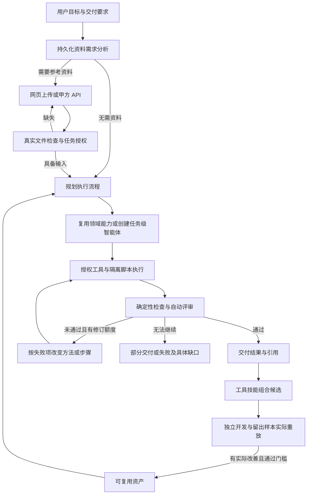

# 航智智能体管理平台架构 v2

## 2026-11-12 自主任务改造契约

自主任务开发以 `main f36f490643da4c7e7fc0ba90daf602c44caa2828` 为代码基线，实施分支为 `codex/autonomous-task-platform`，开发阶段未引入并发分支。2026-11-13 用户明确授权将该版本合入最新主分支；本次集成保留 `main 18c5d36` 的节点交接追踪和共享历史预算配置，并保留双方 Git 历史。当前按顺序执行任务阶段，不建设并发调度。下面的历史段落说明原版接口；与本节冲突的产品流程以本节为准。

普通用户创建任务，只提供目标、交付要求及可选资料。平台先解释所需资料的用途、必需字段、格式与缺失影响；无需参考资料的任务可直接规划。网页上传、甲方 API 和已有授权资产经同一资料服务校验。等待补充输入与人工审核不同：没有人工审核等待状态；资料齐备后在原任务内继续。上传不自动等同于云端授权，开发期仅获准公开资料可进入统一模型网关。

`TaskCase` 是用户持续可见的任务容器，保存目标、资料需求、提交批次、不可变计划版本及执行引用。现有 `TaskRun` 继续作为执行、租约、节点、实例、计费与终态的唯一权威。`PlanVersion` 冻结步骤、依赖、输入输出、智能体和工具版本以及修订原因。流程选择优先使用已有已发布能力，缺口使用当前任务专属智能体；任务成功不等于具备通用性，独立开发与留出评测通过前不得成为跨任务可复用资产。

任务记录删除仅软删除 TaskCase 的用户入口并撤销上游提交凭据，保留不可变执行、资料、审核、资产引用和预算。删除与继续执行、资料提交及评测样本准入按同一任务行锁串行校验；任何关联执行尚在运行或租约/实例未释放时拒绝删除，既有幂等键不得复活已删任务。

新增 schema v3 表 `task_cases`、`data_submissions`、`plan_versions`、`agent_candidates`、`script_versions`、`sandbox_runs`、`review_reports`。DM 迁移仅增加表并更新版本标记，旧定义、版本、任务、身份和审计逐行保留。历史预算仍使用原 `.local/budget.sqlite3`，300 元累计上限不因工作区、业务库、TaskCase 或 TaskRun 变化而重置。规划、模型执行、脚本生成、审核和评测的付费请求统一经过 `model_gateway.py`。

脚本执行是独立受控工具，文档 Skill 不授予宿主代码执行权限。Python 脚本保存不可变代码与哈希，通过已预配容器执行，默认无网络、只读输入、独立输出、无宿主凭据和预算账本，并限制时间、内存、进程与输出。依赖不齐时报告不可用，不运行时下载、不偷偷退回宿主执行。保留关闭外发的离线部署配置，当前公开验证允许云端；离线大模型与本轮依赖整包重装仍需单独验收。

审核区分节点执行成功与交付质量通过。验证任务要求、数据及数学关系、证据位置和文本与产品一致性；失败项进入有界修订。修订记录具体问题、修改动作、受影响步骤、复用条件和前后结果，不能通过降低标准制造通过。B05 的 PDF 正文缺少月度值时，解析阶段改为读取图表印刷标签并复算；已审核数值派生的摘要与原模型表述分开保存，明确有限规则核验的覆盖范围。

前台按新建任务、资料需求、执行进展、结果引用组织；管理台保留资产、监控、工具/技能、审核和版本证据。30 个预设案例是参考能力与回归资料，不是普通用户创建任务的前置条件。工具目录展示实际可用能力和依赖限制，调用轨迹只统计真实执行。

资料需求分析是短暂的持久任务，完成即释放 Worker；等待上传不占用执行租约。管理人员触发候选评测与入库，业务任务不等待这一步。需求、执行及补料后的重试累计使用同一 TaskCase 额度，全部付费仍归入唯一历史账本。详细接口见 [AUTONOMOUS_TASKS.md](AUTONOMOUS_TASKS.md)，公开资料演示见 [DEMO_B05.md](DEMO_B05.md)。

## 历史问答入口与管理入口

历史问答工作台保留在 `/questions`，根路径已由本轮 TaskCase 任务入口接替。历史问答使用项目内预先登记的资料；新任务允许在创建后按资料需求上传。用户读取本人任务或问题的进度、答案、可溯源的引用与缺口。管理视图位于 `/manage`，沿用同一项目、任务执行器和版本记录。

身份分为提问用户、项目操作员、只读观察员和管理员。自行注册的账户默认为提问用户，由管理员分配项目。提问用户只能访问授权项目和本人问答/TaskCase 接口，包括本人任务允许的资料、结果及执行记录；不能借管理 API 获取其他用户资料、任务或全局预算。既有角色及不可变版本保留。

### 用例分析扩展（2026-11-02）

在现有平台中引入 case_analysis 任务类型和固定案例配置，不新建旁路执行服务。TaskRequest.case_id 指定分析和交付契约。项目内发布的资料解析、领域计算与证据核查智能体组成版本化工作流；受理时冻结输入、算法签名和全部版本，原任务 Worker、Agno Workflow 和独立复核仍是状态权威。用户提供的记录只作为数据，不能选择可执行代码或越过授权。审核要求来源版本、位置、产品存在性和任务特定约束，缺口进入有限修订或真实终态。项目监测读取真实节点、实例、尝试、耗时和错误。

当前开发模式允许公开资料通过统一网关调用云模型。部署方显式启用 HANGZHI_OFFLINE=true 时，API 与 Worker 均关闭模型外发；两种模式使用相同数据权限、预算和任务历史。

正式业务及身份运行在达梦 DM8，历史预算账本独立保留。达梦真机验证见 DAMENG.md，旧版 PostgreSQL 记录仅代表历史兼容验证。

2026-10-17。新版共享契约。旧业务由 Git 归档保留，私有原文只保存在忽略目录。

## 岗位与工具执行边界

岗位合同、主算法和工具许可一起发布。32 个用例岗位由共享解析、30 项分析及独立审核组成，岗位主算法标识取自实际调度的函数。固定用例从其授权中按资料类型和产品范围选择有依据的页内核读或领域复算。日常任务和改进评测使用相同的工具检查；复用上一轮检查点时不增加调用次数。云端 Agno 工具循环、本地专员和授权试用共用工具参数契约与处理函数，各自检查项目权限、资产版本、来源范围及撤回状态。工具目录、单个岗位的授权、一次运行实际调用的清单分别展示。

同一岗位当前版本的 `executor_bindings.local/cloud` 冻结两种真实执行器。local 保持固定 `role_tools`；cloud 按 `casework/executors/registry.py` 的静态 stage/case 映射进入 26 个分析族及共享 prepare/review 领域执行器，由 `model_gateway.run_agent()` 创建 Agno Agent 并执行原生 Loop。主处理函数作为本节点版本化 Agno Function，完整输出写入工具检查点，模型只接收紧凑投影、计数和 artifact/checksum 引用。执行器确认引用属于当前节点实例后才物化完整节点输出；伪造引用、证据、版本或位置会进入 `model_output_invalid` 的有界恢复。节点 config 仍为空，action/targets 仍只来自冻结 case_plan，三节点输入输出合同不随 mode 改变。用例 cloud 跳过通用 `v2_independent_review`，避免在独立核查岗位之外重复计费。

技术恢复与账务状态解耦。超时、连接失败、限流、服务端故障、截断和输出合同错误在冻结修订、预算、请求数及截止时间内自动重试；不确定费用始终保留并展示，但不否决恢复。HTTP 400 等请求错误以安全供应商诊断支持工程修复，不盲目重放相同请求。

## 审核如何改变后续执行

每次受理冻结用例算法签名和修复策略版本。用例审核失败后，Worker 依据失败检查、实际解析记录和已经尝试过的操作选择路径。任务自带的文本不具有授予新工具或指定执行代码的权限。修复决定和修订号在同一租约事务保存；成功的上游输出按原节点 ID、专员版本与有效来源复用，独立审核保留。任务详情返回 `repair_history`，记录原因、动作、修复对象、复用节点、重新执行的节点和复核结果。撤回资料时屏蔽派生详情。跨任务候选沿用相同执行和核查规则，用独立开发与留出资料验证改进，达标才改变后续任务的发布版本。

## 系统边界
智能体定义、不可变版本、运行实例分离。任务自动规划、执行、确定性校验、评审与有界修订，没有人工审核等待状态。通用任务支持结构化数据、来源文本、图片检查、本地 RapidOCR 和云视觉理解；用例任务还支持本地 OCR、带时间码的 ASR、辅助翻译、受限视觉匹配与空间计算。具体输入与覆盖边界见[用例手册](CASEWORK.md)。local 使用本机工具或已配置的本地模型，cloud 通过统一网关调用授权模型，rehearsal 显式标记为演练。外部能力优先由 Agno 原生 Toolkit、MCPTools、LocalSkills/Skills 和 Function 执行，平台补充项目权限、不可变版本、预算、审计与撤销。

## 部署与数据
Python/FastAPI + Agno 3.0.10 私有运行时，React/TypeScript 管理台。API 和独立 Worker 共享 SQLAlchemy 数据库；正式启动必须设置达梦连接和 HANGZHI_REQUIRE_DM=true。SQLite 仅用于隔离单元测试或显式历史维护，不替代达梦验收。schema_version 显式管理，迁移工具从已停服、通过校验的旧库导入原有任务、版本和有序事件。
实体表：projects, agents, agent_versions, workflows, workflow_versions, data_assets, tasks, questions, nodes, instances, artifacts, events, schedules, evaluations, improvements, memories, connectors, workers, audits, capability_definitions, capability_versions。每表独立主键、项目、状态、时间与配置；任务有幂等键、租约持有者、递增 token、过期时间、取消标记。能力版本保存不可变 Skill 文档、Toolkit/HTTP 定义或原生 MCP 发现快照及校验和。状态与事件事务提交，事件表作为可重放通知源。冷启动建表和schema标记串行化；schema v1→v2 仅做显式加表迁移，不重置业务或预算数据；业务更新使用行锁及updated_at冲突检查。
身份密码/会话复用已验证组件，正式身份、权限与设置由达梦保存，既有密码散列随停服迁移保留。历史 SQLite 身份源库只用于维护。新部署不生成固定默认密码。admin 全局管理；operator 操作所属项目；reviewer 只读；requester 使用本人项目问答。所有实体读取和写入均验证项目成员。
预算固定历史 .local/budget.sqlite3，不随新库目录迁移。所有模型调用只经过 backend/app/model_gateway.py，保留最坏预留、不确定费用、8000输出上限与300元历史累计上限。AgentOS原生执行API不公开。禁遥测、CDN、自动下载。

## API

`DELETE /api/v2/tasks/{id}` 仅允许有项目写权限的管理员/操作员删除终态且已释放执行器的任务。事务内锁定任务并写入 `deleted_at/deleted_by`，保留状态、幂等键、冻结快照、子记录、问答/评测引用和独立预算账本，追加删除事件与审计。重复删除返回 204。管理任务集合及 bootstrap 排除已删除任务，任务详情/结果/事件/调用接口返回 404；历史统计和既有引用保留。原幂等键不能重新创建或复活已删除任务，复制需使用新键。不新增数据库表或列。
业务前缀 /api/v2；身份 /api/auth/login|register|me|logout，账号管理 /api/users。集合为数组。领域错误 {detail:{code,message}}；身份保留detail字符串，Pydantic校验错误使用FastAPI标准detail数组。写入校验同源和后端角色。领域输入拒绝未知字段；内联资料限2MB，普通文件限10MB，音频与视频上传限128MB，请求体在解析前按路由限制。并发陈旧写入返回409。
- GET /health；GET /bootstrap 返回 {user,projects,agents,workflows,tasks,data_assets,schedules,improvements,connectors,memories,evaluations,capabilities,workers,budget,stats,system}，管理员另有users。
- GET/POST /projects；PUT /projects/{id}/members（admin）。
- GET/POST /agents；GET/PUT /agents/{id}；POST /agents/{id}/publish|disable|enable|retire；DELETE /agents/{id}；GET /agents/{id}/versions|instances。
- GET/POST /workflows；GET/PUT /workflows/{id}；POST /workflows/{id}/publish；GET /workflows/{id}/versions。
- GET/POST /data-assets；POST /data-assets/upload（multipart）；POST /data-assets/{id}/revoke；GET /data-assets/{id}/content。
- GET/POST /tasks（创建返回202与TaskRun.id）；GET /tasks/{id} 包含 nodes,instances,artifacts,events；POST /tasks/{id}/cancel；GET /tasks/{id}/events?after=N&limit=500 数组（最多1000）；GET /tasks/{id}/stream SSE支持Last-Event-ID并持续复核身份/项目，撤销后发access_revoked并关闭；GET /tasks/{id}/result，未终结返回202与task_id/status。
- GET /artifacts/{id} 索引及内容；GET /artifacts/{id}/download 下载。
- GET/POST /schedules；POST /schedules/{id}/disable|enable。持久 interval_seconds,next_run_at,timezone,task_template；计划ID和触发时间构成幂等键。
- GET /capabilities|budget|workers|audits；GET/POST /connectors；POST /knowledge/search；GET/POST /memories。
- GET /capability-definitions；POST /capability-definitions/skills/import|toolkits|tools|mcp；POST /capability-definitions/{id}/discover|publish|disable|enable|revoke|destroy；GET /capability-definitions/{id}/versions。网络目标、launcher 与 secret_ref 仅 admin 管理，普通 operator 可导入纯文档 Skill。
- GET/POST /improvements；POST /improvements/{id}/evaluate|promote|rollback；GET /evaluations。候选仅改变授权配置，保存真实样本和输出，硬回归禁止晋升。

## 字段
AgentSpec: id,project_id,name,description,purpose(general|specialized),structure(atomic|composite),capabilities[],modalities[],tool_ids[],instructions,model_policy(local|cloud),members[{agent_id,version}],parameters,status(draft|published|disabled|retired|destroyed),current_version。发布冻结配置和成员版本，检查循环及深度；复合上层local策略不允许cloud子节点。禁用阻止新任务，存量按快照执行；销毁保留tombstone并检查引用。
WorkflowSpec: id,project_id,name,description,task_type,nodes[{id,label,agent_id,depends_on:[],config:{}}],status,current_version。发布验证DAG和已发布成员，冻结agent版本。未选流程则按能力匹配或白名单模板组装任务级配置，不生成代码。
DataAsset: id,project_id,name,modality(text|structured|image|audio|video),media_type,content,source_id,source_version,provenance,classification(local|public),retention_days,expires_at,checksum,bytes,status(active|revoked)。文本/JSON内联受大小限制；文件content_ref只指向受控存储，不返回浏览器。只有public+cloud任务可外发。撤回/过期阻止读取并失效派生记忆，同时在任务/产物/评测的详情和集合查询中屏蔽派生内容，保留审计与来源标识。
TaskRequest: project_id,name,goal,task_type(structured_transform|source_summary|text_analysis|image_inspect|image_ocr|image_understand|case_analysis|audio_transcribe|video_analyze),input_refs[],workflow_id?,mode(local|cloud|rehearsal),service_class(batch|interactive，默认batch),idempotency_key,deadline_seconds(1..86400),max_cost_cny(0..10),max_revisions(0..2),allow_partial(false),quality{min_records?,required_fields?:[],min_length?}。image_ocr 仅 local/rehearsal，image_understand 仅 cloud 且要求 public 图片。项目内幂等，同键异内容409。旧请求按契约默认值归一化比较，新增默认字段不破坏幂等。
TaskRun: id,project_id,status(accepted|planning|queued|running|evaluating|revising|succeeded|partial|failed|cancelled),reason_code,request,snapshot,attempt,revision,cancel_requested,lease_owner,lease_token,lease_until,result,created_at,updated_at。max_revisions 同时约束质量修订、通用技术恢复与用例技术恢复；普通超时、连接失败、限流、服务端故障和输出合同错误可在额度内恢复，费用是否完整不影响恢复，全部不确定预留继续保留。权限、预算、取消、截止、非法请求和进程接管时仍在途的调用直接终止，避免重复执行未知状态的外部操作。case_analysis 的技术错误以 entry_kind=technical_recovery 写入 repair_history，保持原业务 action/targets 并按阶段复用检查点；业务审核失败仍由冻结 repair_plan 选择替代操作，技术条目不作为已尝试的业务动作。技术恢复发生在业务修复轮时，最终业务 outcome 回写 base_business_revision 对应条目。评审协议错误最多只重试评审一次，不重新执行产物节点。
ResultBundle: task_id,status,mode,reason_code,artifacts[],quality_verdict,warnings[],lineage[],usage,version_refs[]；来源不可用时增加content_withheld,withheld_reason,unavailable_source_refs并清除派生内容。
Node: id,task_id,project_id,node_id,label,agent_id,agent_version,instance_id,status,attempt,output,error,started_at,finished_at。
Instance: id,project_id,task_id,agent_id,agent_version,status(running|released|abandoned),context_id。不同任务从不共享context。
Artifact: id,project_id,task_id,type,media_type,content,checksum,source_refs[],quality_status。
Event: id,sequence,project_id,task_id,node_id?,instance_id?,type,time,trace_id,payload。事件不复制私有全文。

## 模块协作接口

项目名称通过 `PUT /api/v2/projects/{project_id}/name` 修改，只接收 1–100 字的去首尾空白名称。后端事务内检查项目写权限并锁定记录，实际改名追加 `project.renamed` 审计；ID、成员、内容和版本不变。默认项目初始化由 `service.bootstrap_projects()` 在事务内获取 `Repository.lock_project_initialization()` 后重新检查可访问项目；DM/PostgreSQL 锁定既有 schema_version 单行，SQLite 沿用 BEGIN IMMEDIATE，不修改版本标记、不新增表。显式创建项目仍允许同名，前端仅在重名时附加可区分的项目 ID 前缀。

backend/app/platform/db.py: Repository(url=None), repo。transaction() 产生绑定事务的Repository；get(kind,id),list(kind,project_id=None,**filters),put(kind,record),delete(kind,id)；event(task_id,type,payload=None,**refs)；claim(worker_id,lease_seconds=30) 原子领取accepted/queued或过期任务并递增token；fenced(task_id,worker_id,token) 检查租约；heartbeat(task_id,worker_id,token,lease_seconds=30)；finish_claim(task_id,worker_id,token)释放。执行结果必须在transaction内先fenced，再put。
platform/service.py 负责定义/数据/任务受理；platform/contracts.py 是输入Schema；platform/api.py 是路由。
platform/runtime.py 提供 async process_claim(repository,task,worker_id) 以及 runtime_workflow()；platform/worker.py 独立CLI调度、心跳及计划。tool_registry.py 合并内置与项目能力；capability_service.py 管理导入和版本；native_capabilities.py 构造原生 Toolkit/只读 Skills；mcp_runtime.py 只配置并检查 Agno MCPTools；tool_runtime.py 在原生 Function 外层执行权限、审计、证据和租约治理。OCR 由 ocr.py 调用 RapidOCR；视觉图片字节经 model_gateway.py 的原生 Agno Image 输入发送。领域对象只依赖新Repository；模型和身份是显式保留边界。

## 恢复与质量
达梦按调度顺序选择候选任务，对候选行逐一加锁并重验。PostgreSQL兼容分支使用FOR UPDATE SKIP LOCKED；SQLite BEGIN IMMEDIATE。所有结果经过租约令牌验证；旧worker不能写入。完成节点复用。外部调用前记录in_flight，接管未确认调用返回execution_uncertain，禁止盲重放付费请求。取消在途调用不能提前宣称释放。
硬Schema/来源/权限校验不能被模型自评分覆盖，评审上下文独立，同一模型的相关偏差仍需在评审结论中明确。有界修订失败保留原始问题；仅allow_partial时可部分交付。评测目前限定local_atomic_single_node：冻结至少两个真实终态任务样本、基线和候选，最后一个作保留样本；实际重放、记录输出与耗时，禁止硬回归且要求可测增益。数据集和候选均作哈希完整性校验，晋升前复核证据、来源状态和版本。回滚仅切换稳定版本指针，不删除历史，新发布使用最大历史版本+1。

自动改进仅在HANGZHI_AUTO_IMPROVE=true时运行，当前只可依据真实质量失败调整本地提取式文本max_chars；不得修改代码、权限或权重，仍需相同冻结评测门槛。未知能力明确失败。真实上游及模型接入需要实际契约样例与运行证据。

## 验收
成功、缺数据、错Schema、重复键、越权、撤回、过期、不支持能力、模型错误、质量不合格、超时、取消、重复领取、过期接管和旧实例隔离。UI只显示持久状态和账本；无样本不显示成功率。上游接口、多模态、目标硬件和断网部署必须实际验证，不能由本机演练替代。
技术核对：Agno固定版本由平台租约作唯一调度权威，AgentOS运行真实Workflow但不公开原生API。参考 https://docs.agno.com/agent-os/overview 和 https://docs.agno.com/telemetry 。模型目录参考 https://api-docs.deepseek.com/quick_start/pricing/ 。

## 2026-10-21 调度与运行观测

任务受理冻结 snapshot.scheduling：service_class、policy_version=interactive-aging-v1、aging_seconds=60 和 aging_at。领取顺序为取消清理、租约恢复、等待达到阈值的批量任务、交互任务、其他批量任务；同级按创建时间和 ID 排序。SQLite/PG 使用真实 JSON 查询排序和原有事务/行锁，不新增数据库列。已有任务按 batch 兼容，不抢占正在执行的任务；持续超容量时不承诺完成时限。first_claimed_at 在恢复后保留，所有取消终态记录真实 finished_at。

GET /api/v2/metrics?project_id=&window_hours=24&include_rehearsal=false 返回类型化 OperationalMetrics。项目过滤在后端授权并以 SQL 窄字段投影读取，不加载源资料全文。counts/queue 为当前可见任务状态；latency/failure_reasons 仅以真实 finished_at 落入指定窗口的终态取样。端到端时延含排队，分位数线性插值；无样本返回 null，缺少 finished_at 不使用更新时间猜测。默认排除演练，响应明确窗口和样本数。非管理员或指定项目的查询，只统计关联当前可见任务的 Worker，不泄漏其他项目/主机信息。

前端使用真实流程节点/依赖编辑 DAG；参数表单和可视化校验不替代后端发布校验。结果按已保存的表格、文本、来源片段和图片解码数据呈现；模型文本始终作为文本渲染，不执行 HTML。完整 JSON 只用于诊断，来源撤回仍由后端屏蔽。
